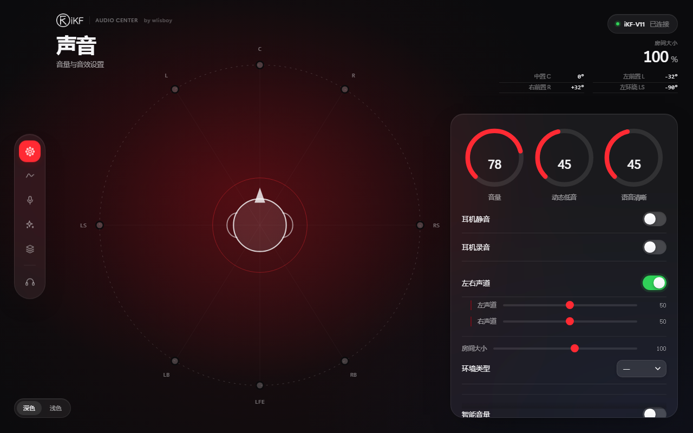
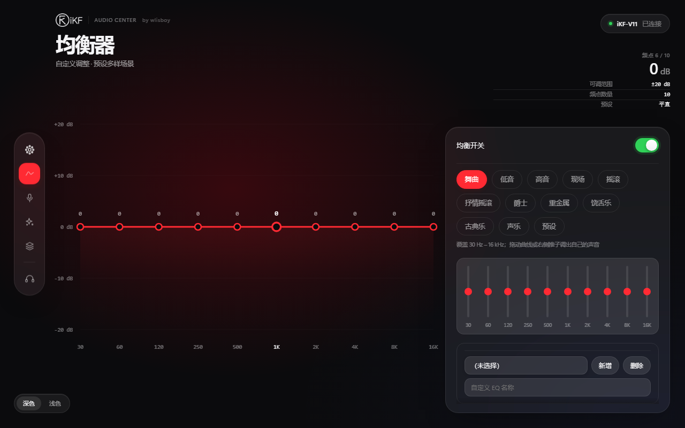
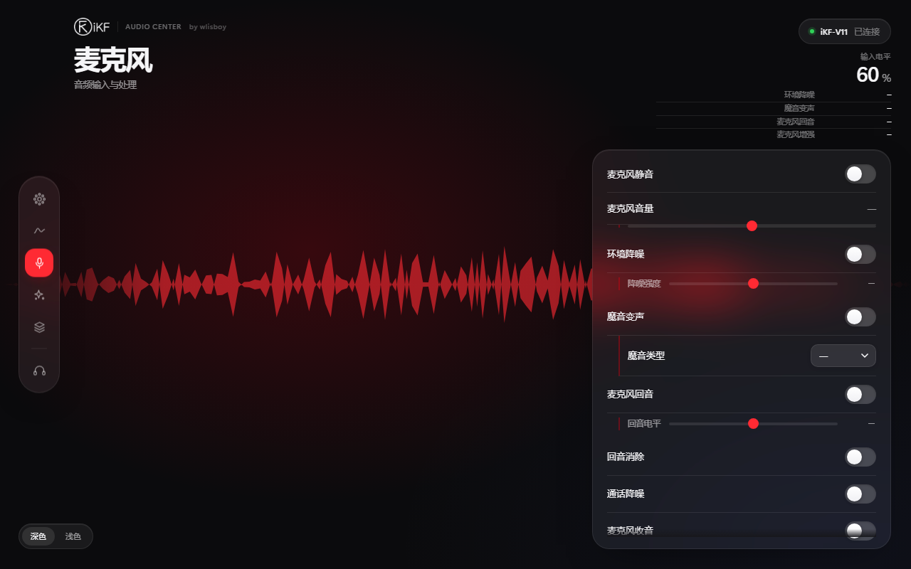

# iKF Audio Center

[](LICENSE)
[](#)
[](https://www.python.org)
[](https://go.dev)
[](audiocore)

iKF Audio Center 是一个面向 iKF 耳机（C-Media 方案）的 Windows 桌面音频控制中心，提供更完整的设备参数调校、场景恢复、频谱分析、监听与回环录音能力。

## 部分页面预览

<table>
  <tr>
    <td width="33%"></td>
    <td width="33%"></td>
    <td width="33%"></td>
  </tr>
  <tr>
    <td align="center">声音设置</td>
    <td align="center">均衡器</td>
    <td align="center">麦克风</td>
  </tr>
</table>

## 功能

- EQ / 环境音效调节
- 虚拟环绕与耳机虚拟化
- 7.1 声道布局与逐声道音量
- 麦克风监听（软件上混）与实时采集
- 耳机端点 loopback 录音
- 实时频谱可视化（Rust FFT 热路）
- 场景管理（8 组态）与初始化自愈
- Windows 桌面应用，支持托盘式启动

## 技术栈

- **Go + Wails** 桌面壳与驱动桥接
- **Rust (audiocore/)** 音频热路：频谱 FFT / loopback / 监听，编译为 `ikf_audio.dll`，运行时优先加载（缺失或 ABI 不匹配自动降级 Go 实现）
- **WebView2** 前端
- **device-model.toml** 参数单一真源（模型/别名/出厂/初始化清单），Go 与 Python 两线运行时装载并自校验，断言不过即拒绝启动
- **Python** 构建/打包脚本

## 快速开始

```bash
git clone https://github.com/wlisboy/iKF-Audio-Center.git
cd iKF-Audio-Center
build.bat            # 一键：构建前端 → cargo(DLL) → go build → 便携包
build.bat -fast      # 跳过便携包打包
```

手工分步：

```bash
python tools/build_center.py                       # Python 线单文件版
python iKF-Audio-Center-Wails/tools/build_frontend.py
cargo build --release --manifest-path iKF-Audio-Center-Wails/audiocore/Cargo.toml
cd iKF-Audio-Center-Wails && go build .
```

## 验证

```bash
cd iKF-Audio-Center-Wails && go test ./...          # 含 DLL ABI/对拍回归
cargo test --manifest-path iKF-Audio-Center-Wails/audiocore/Cargo.toml   # 13 用例 ×2 profile
iKF-Audio-Center-Wails 产出的 exe --self-test       # 设备体检：208 属性 / 80 可写（65+15）
```

最终验收（2026-10-28）：go test 全绿；cargo test dev+release 13/13 ×2；两线
`--self-test` 可写行 65/15 一致；Python 装载断言（208/80/42/1/6/35/53）通过。

## 目录

```text
.
├── LICENSE
├── README.md
├── design/                     # 设计稿与页面预览
├── tools/                      # Python 构建脚本
└── iKF-Audio-Center-Wails/     # Go/Wails 桌面应用
    ├── app.go / main.go / driver.go        # 壳、入口、驱动桥接
    ├── audio.go / audio_lb.go              # 音频热路（Rust 优先，Go 兜底）
    ├── model/device-model.toml             # 参数单一真源（两线共用）
    ├── model.go                            # go:embed 装载与断言
    ├── ikftool/                            # iKFTool 日志诊断工具
    ├── installer/                          # iKF-驱动管理
    ├── audiocore/                          # Rust 音频热路（cdylib → ikf_audio.dll）
    ├── frontend/                           # WebView2 前端
    └── internal/takeover/                  # 端点接管
```

## 要求

- Windows 10 / 11
- Python 3.13+、Go 1.22+、Wails v2、Rust (MSVC)
- 已安装官方 iKF / C-Media 驱动

## 免责声明

本项目仅供学习、研究和个人使用，不与 iKF、C-Media 或官方厂商建立关联。

## License

[MIT](LICENSE)
